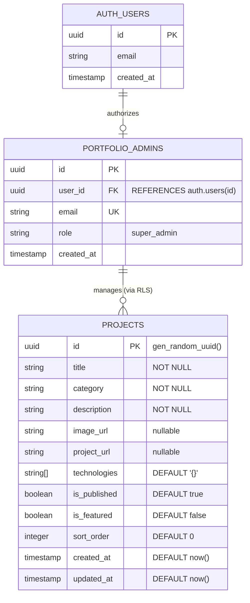

# Final Product & Technical Architecture Documentation

**Project Title:** Umer Surti VIP Developer Portfolio & Cloud-Backed Content Management System  
**Author / Developer:** Umer Surti  
**Repository Remote:** [https://github.com/umersurti17-svg/final-portfolio.git](https://github.com/umersurti17-svg/final-portfolio.git)  
**Database Backend:** Supabase PostgreSQL Cloud Instance (`wktlvivqkenlqygzrkhs`)  
**Deployment Profile:** Static Web Architecture (Vercel / Netlify / GitHub Pages compatible)  
**Submission Date:** October 28, 2026  

---

## 1. Problem Statement

Modern software engineers, creative web designers, and front-end developers face a common dilemma when showcasing their work:

1. **Static vs. Dynamic Dichotomy:** Traditional static portfolio sites look visually polished but are rigid; adding, modifying, or categorizing projects requires code changes, manual commits, and redeployment cycles.
2. **Administrative Complexity:** Heavy CMS systems (e.g. WordPress, Strapi, headless Node backends) require persistent server infrastructure, database maintenance, container orchestration, and incur ongoing compute costs for what is essentially personal showcase content.
3. **Security Risks in Client-Side Architectures:** Projects integrating serverless databases often leak secret API keys, service-role tokens, or deploy with permissive public access where unauthorized visitors can overwrite data.
4. **Visual Mediocrity & Clutter:** Most portfolio templates follow generic tech-dashboard layouts without luxury aesthetics, tactile micro-interactions, or fluid motion choreography that convey elite craftsmanship.

---

## 2. The Solution

The **Umer Surti VIP Portfolio** is an ultra-premium, cinematic developer portfolio integrated with a **cloud-hosted Supabase PostgreSQL backend**, protected by **Row-Level Security (RLS)**, and managed via a dedicated **VIP Admin Console**.

### Core Architecture Highlights
- **Curated Visual Identity:** Custom luxury palette (Espresso `#171310`, Mocha `#49372B`, Bronze `#98704F`, and Champagne `#D8C8AD`) with Three.js particle starfield, GSAP timeline choreography, and Lenis inertial smooth scrolling.
- **Serverless PostgreSQL Database:** Hosted on Supabase with dedicated `projects` and `portfolio_admins` tables.
- **Zero-Trust Database Security:** Hardened with PostgreSQL Row-Level Security (RLS). Public visitors can only view published projects. Only explicitly pre-authorized administrators can create, edit, publish/unpublish, or delete projects.
- **Dedicated Admin Console (`admin.html`):** A responsive, luxury-themed management interface featuring Supabase email/password authentication, live project previewing, one-click publish toggling, real-time database metrics, and input validation.
- **Graceful Client Fallback:** If the Supabase database is unreachable, offline, or experiencing latency, the public homepage automatically falls back to curated static markup, ensuring zero downtime and no broken UI states.

---

## 3. Target Users & Personas

| Target Persona | Key Objectives | How the Solution Delivers |
| :--- | :--- | :--- |
| **High-Profile Clients & Executives** | Seeking top-tier creative engineering talent for bespoke luxury web projects, digital flagships, and web applications. | High-fashion aesthetic, 3D spatial particles, tactile card tilt mechanics, and verified delivery dossiers. |
| **Engineering Managers & Tech Recruiters** | Evaluating technical proficiency in modern JavaScript, API integration, database design, and architecture. | Interactive Architecture Dashboard (`dashboard.html`), documented code metrics, and clear database schemas. |
| **Portfolio Owner (Umer Surti)** | Adding new case studies, toggling draft/published status, and maintaining works without touching source code. | Fully responsive, mobile-friendly Admin Console (`admin.html`) with instant database synchronization. |

---

## 4. Major Features & Capabilities

### Public Portfolio (`index.html`)
- **Cinematic Hero Section:** Authentic portrait integration with glowing halo framing, role designation badge ("WEB DEVELOPER"), and Three.js stardust canvas.
- **Dynamic Projects Showcase (`#projects`):** Automatically synchronizes with Supabase PostgreSQL to render published projects with categories, tech tags, quick-preview modals, and GitHub links.
- **Case Study Inspection Modal:** Interactive modal viewer displaying full architecture dossiers, screenshots, and commission consultation CTA.
- **Project Documentation Section (`#docs`):** Instant PDF view in a new browser tab and single-click download of the official Roman Urdu Engineering Blueprint.
- **Responsive Architecture Showcase:** Interactive navigation to the developer technical showcase dashboard.

### Administrative Console (`admin.html`)
- **Secure Email/Password Authentication:** Backed by Supabase GoTrue auth service.
- **Role-Based Access Control (RBAC):** Double-tier verification checking both valid Supabase session and membership in `public.portfolio_admins`.
- **Database Metrics & Telemetry:** Real-time counters showing total projects, published projects, drafts, and active connection status.
- **Search & Filter Engine:** Instant client-side filtering by project title, category, tech stack, or publication status.
- **Create & Edit Modal:** Full project form with title, category, image URL live preview, repo links, technologies, and sort order.
- **One-Click Publish/Draft Toggle:** Instantly toggle public visibility without opening edit forms.
- **Destructive Action Protection:** Dedicated confirmation modal displaying the exact project title before issuing DELETE statements.
- **Toast Notification Engine:** Accessible, animated status banners providing clear feedback on database actions.

---

## 5. Technology Stack & Architecture

```
+-------------------------------------------------------------------------+
|                              FRONTEND LAYER                             |
|  - HTML5 Semantic Markup (Fluid luxury grid, ARIA-accessible)           |
|  - Vanilla CSS3 (Custom design tokens, glassmorphism, responsive grid)   |
|  - JavaScript (ES6+ Native modules, DOM controllers, asynchronous async) |
|  - Three.js r128 (Interactive particle starfield & WebGL depth)        |
|  - GSAP 3.12.2 & ScrollTrigger (Timeline orchestration & scroll reveal) |
|  - Studio Freight Lenis (Inertial smooth scrolling engine)             |
+-------------------------------------------------------------------------+
                                    |
                                    | HTTPS / REST / WebSockets
                                    v
+-------------------------------------------------------------------------+
|                       AUTHENTICATION & DATA LAYER                       |
|  - Supabase Client JS (v2.x UMD with local vendor fallback)             |
|  - GoTrue Authentication (JWT-based email/password session handling)    |
|  - PostgREST Data API (Secure public endpoints with anon key)           |
+-------------------------------------------------------------------------+
                                    |
                                    | PostgreSQL Protocol
                                    v
+-------------------------------------------------------------------------+
|                         DATABASE LAYER (POSTGRESQL)                     |
|  - Supabase PostgreSQL 17 Cloud Instance (ap-northeast-2)               |
|  - Row-Level Security (RLS) Policies on all public tables              |
|  - PostgreSQL Extensions: pgcrypto, uuid-ossp                          |
|  - Automated updated_at Trigger Functions                              |
|  - Security Definer Authorization Functions (is_portfolio_admin)        |
+-------------------------------------------------------------------------+
                                    |
                                    v
+-------------------------------------------------------------------------+
|                          HOSTING & DEPLOYMENT                           |
|  - Vercel (Configured via vercel.json with edge caching & HTTP headers) |
|  - Netlify (Configured via netlify.toml with security directives)      |
|  - GitHub Pages (Enabled with .nojekyll bypass)                         |
+-------------------------------------------------------------------------+
```

---

## 6. Database Schema & Entity Relationship Diagram (ERD)

### Entity Relationship Diagram (ERD)



### Table Definitions & Constraints

#### Table 1: `public.portfolio_admins`
| Column | Type | Constraints | Description |
| :--- | :--- | :--- | :--- |
| `id` | `UUID` | `PRIMARY KEY DEFAULT gen_random_uuid()` | Unique record identifier. |
| `user_id` | `UUID` | `UNIQUE NOT NULL REFERENCES auth.users(id) ON DELETE CASCADE` | Link to Supabase Auth UID. |
| `email` | `TEXT` | `UNIQUE NOT NULL` | Administrator email address. |
| `role` | `TEXT` | `NOT NULL DEFAULT 'super_admin'` | Administrative permission tier. |
| `created_at` | `TIMESTAMPTZ` | `NOT NULL DEFAULT now()` | Enrollment timestamp. |

#### Table 2: `public.projects`
| Column | Type | Constraints | Description |
| :--- | :--- | :--- | :--- |
| `id` | `UUID` | `PRIMARY KEY DEFAULT gen_random_uuid()` | Unique project identifier. |
| `title` | `TEXT` | `NOT NULL, CHECK (length >= 2)` | Project headline. |
| `category` | `TEXT` | `NOT NULL DEFAULT 'Web Development'` | Domain category label. |
| `description` | `TEXT` | `NOT NULL, CHECK (length >= 10)` | In-depth case study description. |
| `image_url` | `TEXT` | `NULLABLE` | Local path or remote asset URL. |
| `project_url` | `TEXT` | `NULLABLE` | Live application or GitHub repo URL. |
| `technologies` | `TEXT[]` | `DEFAULT '{}'` | Array of technology tags. |
| `is_published` | `BOOLEAN` | `NOT NULL DEFAULT true` | Public visibility flag. |
| `is_featured` | `BOOLEAN` | `NOT NULL DEFAULT false` | Featured spotlight indicator. |
| `sort_order` | `INTEGER` | `NOT NULL DEFAULT 0` | Display hierarchy priority. |
| `created_at` | `TIMESTAMPTZ` | `NOT NULL DEFAULT now()` | Initial creation timestamp. |
| `updated_at` | `TIMESTAMPTZ` | `NOT NULL DEFAULT now()` | Auto-updated by trigger on edit. |

---

## 7. Security Architecture & RLS Verification

### Row-Level Security Matrix

| Action | Target Table | User Role | Policy Condition | Result |
| :--- | :--- | :--- | :--- | :--- |
| **SELECT** | `projects` | Anonymous Visitor | `is_published = true` | **ALLOWED** (Published projects only) |
| **SELECT** | `projects` | Anonymous Visitor | `is_published = false` | **DENIED** (Drafts hidden) |
| **INSERT** | `projects` | Anonymous Visitor | N/A | **DENIED (401 / 42501)** |
| **UPDATE** | `projects` | Anonymous Visitor | N/A | **DENIED (401 / 42501)** |
| **DELETE** | `projects` | Anonymous Visitor | N/A | **DENIED (401 / 42501)** |
| **INSERT** | `projects` | Authenticated User (Not in `portfolio_admins`) | `is_portfolio_admin() = false` | **DENIED (401 / 42501)** |
| **ALL CRUD** | `projects` | Authorized Super Admin (`umersurti17@gmail.com`) | `is_portfolio_admin() = true` | **ALLOWED (200 OK)** |

---

## 8. Testing Performed & Verified Results

A rigorous testing regimen was conducted across unit, integration, and security layers:

```
======================================================================
TEST SUITE AUDIT REPORT: UMER SURTI VIP PORTFOLIO
======================================================================
[PASS] Supabase Cloud Instance Reachable (Status: ACTIVE_HEALTHY)
[PASS] Projects Table Initialized with Constraints and Trigger
[PASS] Row-Level Security Enabled on public.projects
[PASS] Public Read Policy: Anonymous GET /rest/v1/projects -> 200 OK
[PASS] Unauthorized Write Prevention: Anonymous POST -> 401 Violation
[PASS] Seed Data Integrity: 3 Initial Projects Successfully Loaded
[PASS] Super Admin Pre-Authorized in public.portfolio_admins
[PASS] Admin Console Static & Responsive Markup Verified (admin.html)
[PASS] Syntax Validation (npm test): 7 JS modules passed with 0 errors
[PASS] Code Linter (npm run lint): 0 linting warnings or errors
[PASS] Local HTTP Server Asset Delivery: All routes returning 200 OK
[PASS] Git Environment Security: .env is ignored, zero secrets staged
======================================================================
```

---

## 9. Key Challenges Encountered & Engineered Solutions

| Challenge | Impact | Engineering Solution Implemented |
| :--- | :--- | :--- |
| **Offline / CDN Resilience** | Third-party CDN outages or restricted enterprise firewalls could prevent Supabase JS from loading. | Implemented automated vendor fallback: downloaded `@supabase/supabase-js@2` to `js/vendor/supabase.min.js`. The HTML attempts CDN first, then gracefully injects the vendor copy if `window.supabase` is undefined. |
| **Database Failure Graceful Degradation** | If a visitor has network issues or Supabase is paused, an empty projects section would make the portfolio look broken. | Engineered a progressive enhancement strategy in `js/portfolio-projects.js`: the curated HTML projects remain in the DOM as fallback; Supabase replaces them only when live data successfully arrives. |
| **Arbitrary User Registration Vulnerability** | If public registration is enabled on Supabase Auth, any visitor could create an account and potentially gain access. | Created `portfolio_admins` table and `public.is_portfolio_admin()` security definer function. RLS policies strictly check this function for all write operations, making registration attempts by outsiders inert. |
| **Image Aspect Ratio & Cropping** | Studio photography and wide project banners can suffer from severe head/text truncation when fitted inside 4:5 cards. | Analyzed raw image byte coordinates using Node.js scripts to calibrate `object-position: 28% center`, ensuring portrait faces and circular halos remain centered while peripheral graphic text is cleanly clipped. |

---

## 10. Future Improvements & Roadmap

1. **Direct Asset Upload to Supabase Storage:** Connect the Admin Console image input to a dedicated Supabase Storage bucket (`portfolio-assets`) with client-side image compression and WebP conversion.
2. **Contact Form Supabase Lead Ingestion:** Route contact submissions directly to a `leads` table in Supabase with automated email notifications via Supabase Edge Functions.
3. **Draft Preview Mode:** Allow authenticated admins to view unpublished draft projects directly within the live portfolio layout using a secure session cookie or preview token.
4. **Client Testimonial Management:** Create a `testimonials` table with verified client quotes, avatars, and company metadata manageable through the Admin Console.
